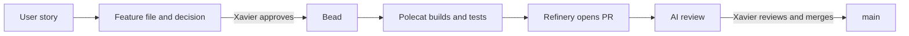

# CM: membership management for a recreational club

CPS845 Project 1, by Xavier Lin. A web app for a recreational club's
customers, coaches and treasurer: profiles, sessions, check-ins, payments
and notifications. The user stories are in `docs/user-stories.md`.

## Stack

| Part | Technology |
|---|---|
| Frontend | React with TypeScript (Vite) |
| Backend | FastAPI (Python), managed with `uv` |
| Storage | SQLite |
| Packaging | One Docker image serving the API and the built frontend |

Emails (profile confirmation, session and payment notices) are written to a
local outbox table and the server log instead of being sent, so the project
runs with no mail service.

## Running it

```sh
docker build -t cps845-cm .
docker run --rm -p 8000:8000 -v cm-data:/data cps845-cm
```

Then open http://localhost:8000.

## AI tooling

This project was built with AI agents, as the course requires. Xavier Lin
directed the work, wrote and approved the specifications and decisions,
reviewed every pull request, and merged them.

The agents run in **Gas City**, a multi-agent orchestration system for
coding agents, using the gastown pack from
[gastownhall/gascity-packs](https://github.com/gastownhall/gascity-packs).
Credit to the Gas City project for the orchestration, the work-item
tracking and the agent roles below. Xavier's own Gas City setup ("car-city",
a private repository) adds the architect role, review rules and checks.

### Agents and what they do

| Agent | Model | Function |
|---|---|---|
| Architect | Claude Opus (Anthropic), in Claude Code | Turns the user stories into Gherkin feature files and design decisions, splits work into beads, and briefs reviews. Never edits code. |
| Mayor | Claude (Anthropic) | Dispatches approved beads to polecats and keeps the city's work moving. |
| Polecat | Claude Sonnet (Anthropic) | Builds one bead at a time on its own branch: code, tests, docs, then hands off. |
| Refinery | Claude Sonnet (Anthropic) | Publishes a polecat's branch and opens or updates the pull request. Never merges. |
| Witness | Claude Haiku (Anthropic) | Watches the rig's polecats and refinery and reports stuck or leaked work. |
| Deacon | Claude Sonnet (Anthropic) | City-wide health patrol. |
| Boot, dogs | Claude Haiku (Anthropic) | Start-up and housekeeping helpers. |
| Reviewer | Codex (OpenAI) | Reviews pull requests and reports findings. |
| Mythos reviewer | Claude Mythos (Anthropic) | Independent security and correctness review, on request. |

### Other tools

- **Claude Code** (Anthropic): the coding agent each Claude role runs in.
- **Beads** (`bd`): Gas City's work-item tracker. Every change starts as a
  bead.
- **Gherkin feature files** in `features/`: one per use case, each scenario
  bound to a test.
- **GitHub and `gh`**: pull requests and reviews.

### How a change flows



Commit messages and pull requests note the model that wrote and reviewed
each change ("Reviewed with ...").
